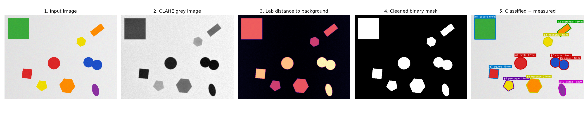
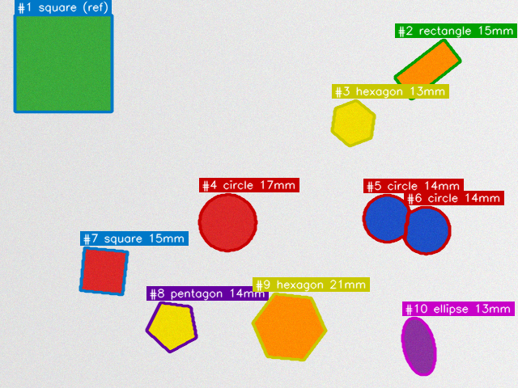

# ObjectLens - Object Detection, Classification & Measurement with Computer Vision

> Course project for **Computer Vision** - VITyarthi *Build Your Own Project*.



## Overview
ObjectLens analyses a photo of objects on a plain background and automatically **finds each object, recognises its shape and colour, and measures its real size in millimetres**. It is built entirely from classical computer-vision techniques (colour spaces, thresholding, morphology, distance transform, watershed, contours, image moments) combined with a small supervised machine-learning classifier. Everything is explainable, runs on a laptop CPU in well under a second per image, and is covered by 70 automated tests.

See [`statement.md`](statement.md) for the problem statement, scope and target users, and [`docs/DESIGN.md`](docs/DESIGN.md) for requirements, architecture and UML diagrams.

## Features
- **Robust segmentation** - background colour estimated from the image border, per-pixel CIE-Lab distance, clamped Otsu threshold, morphological clean-up, half-maximum edge refinement (works on light *and* dark backgrounds).
- **Touching-object separation** - distance transform + marker-controlled watershed with noise-core filtering.
- **Shape classification** - 8 classes (circle, ellipse, triangle, square, rectangle, pentagon, hexagon, star) with SVM / Random Forest / k-NN, plus a rule-based baseline for comparison; low-confidence results are labelled `unknown`.
- **Colour naming** - HSV based (red, orange, yellow, green, cyan, blue, purple, ...).
- **Real-world measurement** - calibrate from a reference square (e.g. a green 30 mm marker) or a given pixels-per-mm value; reports length, width, area, perimeter and equivalent diameter.
- **Reports** - annotated image, binary mask, CSV, JSON, bar chart.
- **History database** - every analysis can be stored in SQLite and queried later.
- **Synthetic data + evaluation** - scene generator with exact ground truth, held-out accuracy, end-to-end metrics, noise-robustness study.
- **Production habits** - input validation, custom exceptions, rotating log file, typed/documented modules, unit + integration tests.

## Technologies / tools used
Python 3.10+, OpenCV, NumPy, scikit-learn, joblib, Matplotlib, SQLite (`sqlite3`), pytest, Graphviz (only to redraw diagrams), Git/GitHub.

## Project structure
```
ObjectLens/
├── main.py                    # CLI entry point
├── requirements.txt
├── README.md   statement.md
├── objectlens/                # application package
│   ├── config.py              # validated configuration
│   ├── exceptions.py          # custom error hierarchy
│   ├── logging_setup.py       # console + rotating file logging
│   ├── preprocessing.py       # load/validate, resize, blur, CLAHE
│   ├── segmentation.py        # Lab distance, Otsu, morphology, watershed
│   ├── features.py            # shape / moment / colour features
│   ├── classifier.py          # SVM / RF / kNN + rule-based baseline
│   ├── measurement.py         # calibration and mm measurements
│   ├── pipeline.py            # orchestrates all stages
│   ├── reporting.py           # annotation, CSV, JSON, chart
│   ├── storage.py             # SQLite repository
│   ├── synthetic.py           # scene generator with ground truth
│   ├── evaluation.py          # metrics and robustness study
│   └── cli.py                 # argparse commands
├── tests/                     # 70 pytest tests
├── scripts/                   # make_diagrams.py, make_results.py, build_report.py
├── data/samples/              # example input images
└── docs/                      # DESIGN.md, diagrams/, results/, report
```

## Installation & running
```bash
# 1. clone and enter the project
git clone <your-repository-url>
cd ObjectLens

# 2. (recommended) create a virtual environment
python -m venv .venv
source .venv/bin/activate          # Windows: .venv\Scripts\activate

# 3. install dependencies
pip install -r requirements.txt

# 4. train the classifier (takes ~10 s, uses generated synthetic data)
python main.py train

# 5. run the built-in demo (generates a scene and analyses it)
python main.py demo --save-db
```
Results (annotated image, mask, CSV, JSON, chart) are written to `outputs/`.

### Analyse your own image
```bash
# with a green 30 mm reference square visible in the picture
python main.py analyze data/samples/scene_light.png --ref-color green --ref-side-mm 30 --save-db

# or with a known scale (pixels per millimetre of the ORIGINAL image)
python main.py analyze my_photo.jpg --pixels-per-mm 6.5

# browse stored analyses
python main.py history
python main.py history --run 1
```
Photo requirements: objects on a plain, evenly lit background, shot roughly top-down.

### All commands
| Command | Purpose |
|---------|---------|
| `train [--samples N] [--algorithm svm\|random_forest\|knn]` | generate data, train and save the model |
| `analyze IMAGE [--ref-color C --ref-side-mm MM] [--pixels-per-mm P] [--save-db]` | analyse one image |
| `demo [--seed S] [--save-db]` | create a synthetic scene and analyse it |
| `evaluate [--scenes N]` | classifier metrics + end-to-end + noise robustness -> `docs/results/metrics.json` |
| `history [--limit N] [--run ID]` | list stored analyses / show detections of one run |

Global options: `--log-level`, `--log-file`, `--model`, `--db`.

## Testing
```bash
python -m pytest -q          # runs all 70 tests (~10 s)
```
The suite covers configuration validation, image loading errors, segmentation (blank image, dark background, touching objects, specks), feature values, classifier training/saving/error cases, calibration maths, SQLite persistence (including cascade delete and SQL-injection safety), reporting files, the full pipeline and the CLI (including graceful error exit codes).

Re-create figures and metrics:
```bash
python main.py evaluate                  # metrics.json
python scripts/make_results.py           # result figures + sample images
python scripts/make_diagrams.py          # UML / architecture diagrams (needs Graphviz)
python scripts/build_report.py           # project report PDF (needs reportlab)
```

## Results (synthetic ground-truth benchmark)
| Metric | Value |
|--------|-------|
| Shape classifier, held-out accuracy (520 samples, 8 classes) | **100 %** |
| 5-fold CV accuracy: SVM / Random Forest / k-NN / rule-based | 99.9 % / 100 % / 99.9 % / 98.0 % |
| Detection precision & recall (40 scenes, 348 objects incl. touching pairs) | **100 % / 100 %** |
| Shape classification accuracy inside full scenes | **100 %** |
| Median / mean area error after reference calibration | **0.64 % / 0.97 %** |
| Noise robustness (Gaussian sigma 5 -> 45 grey levels) | no loss of recall or accuracy |
| Run time per image on CPU (640x480 / 1920x1440) | ~49 ms / ~144 ms |



### Honest limitations
- All quantitative results use **synthetic** images (clean geometric shapes, uniform background). Numbers on real photographs with shadows, glare and perspective will be lower - this is the main item of future work.
- A plain background and an approximately top-down camera are assumed; perspective distortion is not corrected.
- Models are loaded with `joblib`; only load model files that you trained yourself (like any pickle-based format they can execute code if tampered with).

## Documentation
- [`statement.md`](statement.md) - problem statement, scope, users, features
- [`docs/DESIGN.md`](docs/DESIGN.md) - requirements, architecture, UML, ER, design decisions
- Project report PDF - `docs/ObjectLens_Project_Report.pdf`
