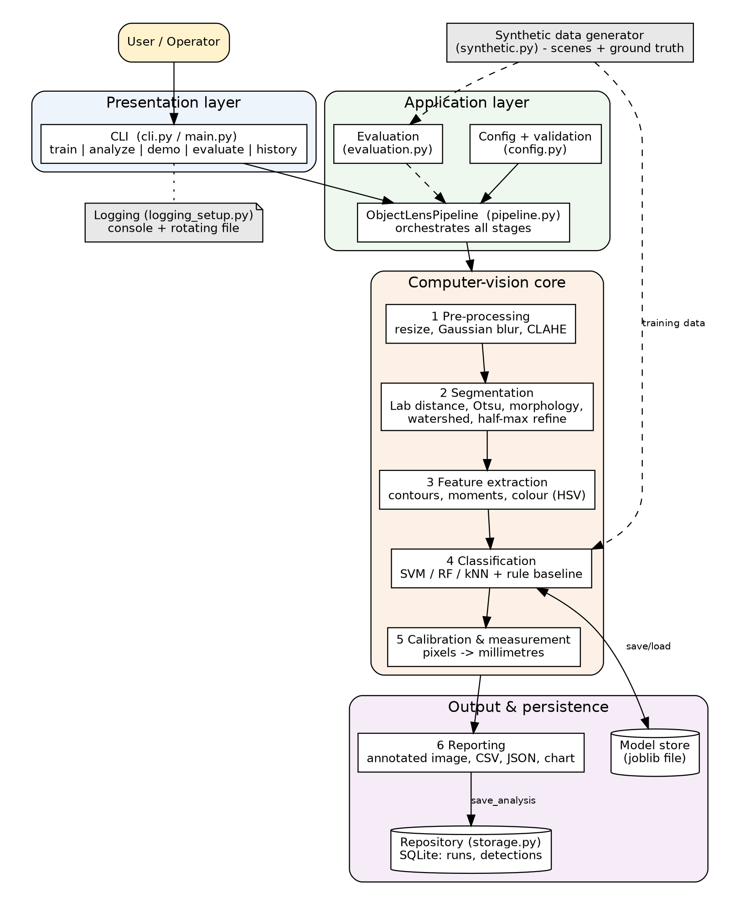
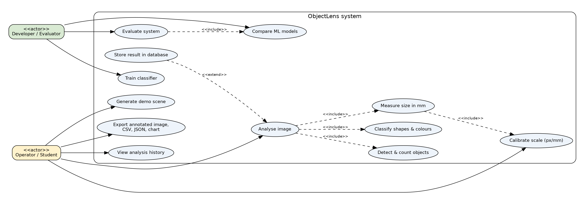
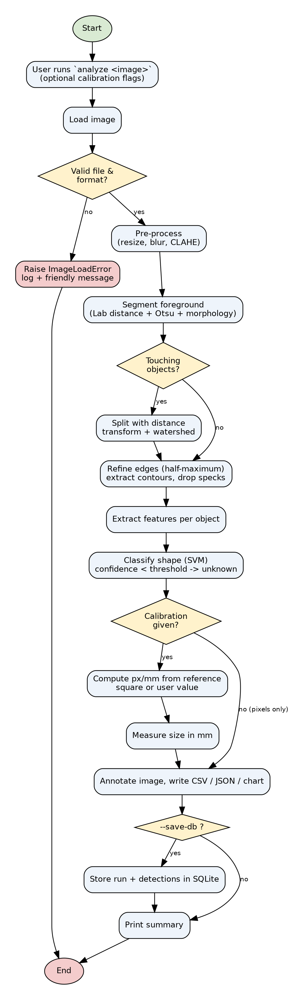
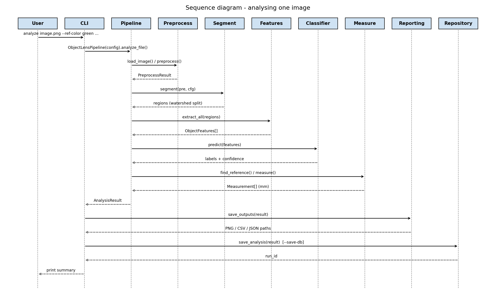
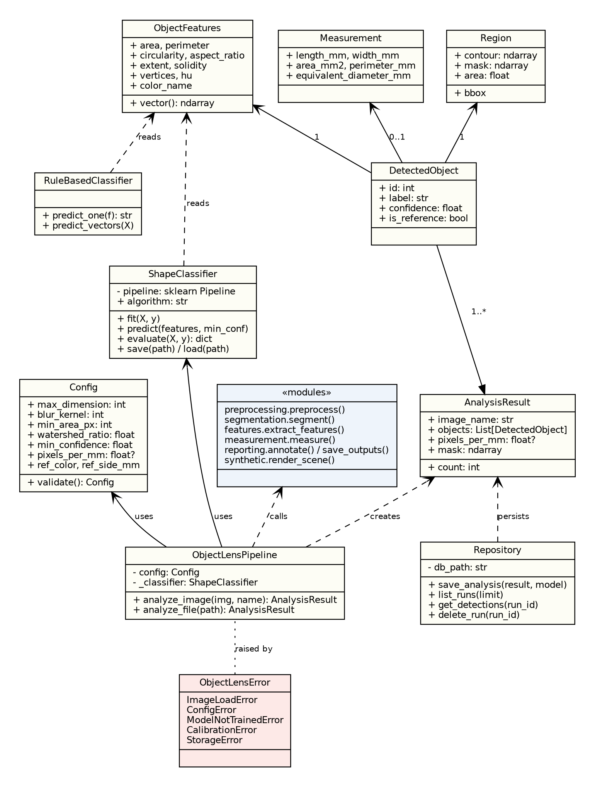
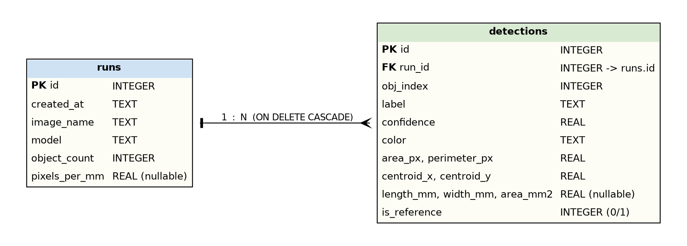

# ObjectLens - Design Document

## 1. Problem statement
Counting, classifying and sizing small objects by hand is slow and error-prone; commercial machine-vision is costly and opaque. ObjectLens offers a transparent computer-vision pipeline that turns a photo of objects on a plain background into counts, shape/colour labels and real-world measurements. (Full text: [`../statement.md`](../statement.md).)

## 2. Objectives
1. Detect all objects in an image, including objects that touch.
2. Classify each object's shape and colour with a trained, confidence-aware model.
3. Convert pixel measurements to millimetres using a reference marker.
4. Provide reproducible reports (image, CSV, JSON, chart) and a searchable history.
5. Quantify accuracy and robustness on data with exact ground truth.
6. Keep the code modular, tested, documented and easy to extend.

## 3. Functional requirements
| ID | Requirement | Module |
|----|-------------|--------|
| FR1 | Load and validate an image (existence, extension whitelist, decodability). | `preprocessing` |
| FR2 | Pre-process: resize large images, Gaussian denoise, CLAHE. | `preprocessing` |
| FR3 | Segment foreground from background on light or dark plain backgrounds. | `segmentation` |
| FR4 | Split touching objects (distance transform + watershed). | `segmentation` |
| FR5 | Extract shape (area, perimeter, circularity, aspect ratio, extent, solidity, vertices, Hu moments) and colour features. | `features` |
| FR6 | Train, save, load and apply an ML classifier; report confidence; label low-confidence results `unknown`. | `classifier` |
| FR7 | Calibrate pixels-per-mm from a reference square or a given value. | `measurement` |
| FR8 | Measure length, width, area, perimeter, equivalent diameter in mm. | `measurement` |
| FR9 | Export annotated image, mask, CSV, JSON and a count chart. | `reporting` |
| FR10 | Store each analysis in SQLite and list / inspect stored runs. | `storage` |
| FR11 | Generate synthetic annotated scenes; evaluate classifier and pipeline; compare models. | `synthetic`, `evaluation` |
| FR12 | Provide a CLI with `train`, `analyze`, `demo`, `evaluate`, `history`. | `cli` |

**Input / output structure.** Input: image file (PNG/JPG/BMP/TIFF/WEBP) + optional calibration flags. Output: console summary, `*_annotated.png`, `*_mask.png`, `*_objects.csv`, `*_report.json`, `*_chart.png`, optional database rows.

**Workflow.** train model -> analyse image -> inspect/export results -> (optionally) store and review history. See the workflow diagram below.

## 4. Non-functional requirements
| ID | Category | Requirement | How it is met / verified |
|----|----------|-------------|--------------------------|
| NFR1 | Performance | Analyse a 640x480 image in < 0.2 s and a 1920x1440 image in < 0.5 s on a laptop CPU. | Images are down-scaled to <= 1024 px; vectorised OpenCV/NumPy. Measured: ~49 ms and ~144 ms. |
| NFR2 | Reliability & error handling | Bad input must never crash the program with a stack trace. | Custom exception hierarchy; CLI maps `ObjectLensError` to exit code 2 with a friendly message, unexpected errors to exit code 1 plus a logged traceback. Tested. |
| NFR3 | Security | No SQL injection; inputs validated; no code execution from user data. | Parameterised queries only, integer coercion of ids, extension whitelist, config validation. |
| NFR4 | Usability | Self-explanatory CLI and readable outputs. | `--help` for every command, annotated images, plain-text summary, clear error messages. |
| NFR5 | Maintainability | Small single-purpose modules, type hints, docstrings, automated tests. | 14 modules, 70 tests. |
| NFR6 | Logging / monitoring | Every run leaves an audit trail. | Console + rotating file log (`outputs/objectlens.log`), levels configurable. |
| NFR7 | Resource efficiency | Run on CPU with modest memory, no GPU. | Classical CV + small SVM (< 1 MB model). |
| NFR8 | Reproducibility | Identical results for identical seeds. | Seeded NumPy generators and scikit-learn `random_state`. |

## 5. System architecture

Layers: presentation (CLI) -> application (pipeline, configuration, evaluation) -> computer-vision core (five stages) -> output & persistence (reporting, SQLite, model store). The synthetic-data module feeds training and evaluation only.

## 6. Design diagrams
### 6.1 Use case diagram

### 6.2 Workflow diagram

### 6.3 Sequence diagram

### 6.4 Class / component diagram

### 6.5 ER diagram (SQLite)

Schema (see `objectlens/storage.py`): `runs(id PK, created_at, image_name, model, object_count, pixels_per_mm)` and `detections(id PK, run_id FK -> runs.id ON DELETE CASCADE, obj_index, label, confidence, color, area_px, perimeter_px, centroid_x, centroid_y, length_mm, width_mm, area_mm2, is_reference)`, with an index on `detections.run_id`.

## 7. Machine-learning documentation
**Dataset.** Generated on demand by `synthetic.py`: 8 shape classes, random size (radius 28-95 px), rotation, colour (6-colour palette), background (light / dark / cream) with a brightness gradient and Gaussian noise (sigma 2-9). Each sample is rendered, then passed through the *real* segmentation and feature code so training and inference share one feature distribution. Circle samples also include watershed-separated circles. Default: 150 samples per class (+50 split circles) = 1 300 training samples; independent test set 520 samples.

**Model selection rationale.** Features are low-dimensional (8) and scale-invariant, so classical models are appropriate. SVM (RBF) was chosen for smooth probability estimates (confidence thresholding) and small-data strength; Random Forest and k-NN are compared; a hand-written rule-based classifier is the baseline.

**Evaluation methodology.** (1) Held-out test accuracy, confusion matrix and per-class report; (2) 5-fold stratified cross-validation of every model; (3) end-to-end scene evaluation: nearest-centroid matching of detections to ground truth gives precision, recall, classification and colour accuracy, count accuracy and area error in mm^2; (4) noise-robustness sweep.

## 8. Key design decisions & rationale
| Decision | Rationale |
|----------|-----------|
| Segment by **Lab distance from the border colour** instead of grey-level Otsu | Independent of object colour/brightness; handles light and dark backgrounds without a polarity heuristic; yellow-on-white objects are not lost. |
| **Clamped Otsu** threshold (15-40 Lab units) | Otsu alone fails for images with one very high-contrast and one low-contrast object, or no object at all. |
| **Half-maximum edge refinement** per object | The permissive global threshold over-grew masks (area error 4-7 %); refinement moved the boundary to the true edge and cut the median area error to 0.64 %. |
| **Solidity gate + adaptive watershed ratio + noise-core filter** | Convex objects are never split; weak necks are still separated; a 3-pixel noise core once created a sliver object (regression test added). |
| Classifier trained on features of **real pipeline output** | Prevents train/inference mismatch (e.g. digital-contour perimeter bias). |
| **Reference-square calibration** | Needs no camera intrinsics; one visible marker gives px/mm per image. |
| **Confidence threshold -> `unknown`** | Better to flag an uncertain object than to report a wrong shape confidently. |
| **SQLite + repository class** | Zero-configuration persistence with transactions and cascade delete. |
| Synthetic generator with exact ground truth | Enables automatic, reproducible measurement of detection and size error without manual annotation. |
